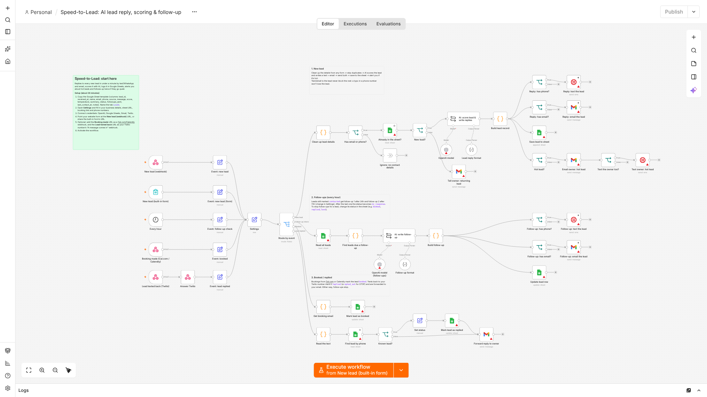

# Speed-to-Lead: setup guide

Replies to every new lead within a minute by text (or WhatsApp) and email, scores the lead with AI, logs it in Google Sheets, alerts the owner about hot leads, and follows up twice if the lead goes quiet. Follow-ups stop automatically when the lead books or texts back.



**Files:** `speed-to-lead.workflow.json` (import into n8n) · `leads-sheet-template.csv` (header row for the Google Sheet)
**Setup time:** about 20 minutes · **Tested on:** n8n 2.42

---

## What you need
| Account | Used for | Cost |
|---|---|---|
| n8n (Cloud or self-hosted) | Runs the workflow | n8n Cloud from about $24/mo, or a $5 to $10/mo server |
| OpenAI API key | Scoring the lead and writing replies (default model `gpt-5-mini`) | A few cents per lead at most |
| Google account | The leads sheet (Google Sheets) and sending email (Gmail) | Free |
| Twilio | Text messages (or WhatsApp) to leads and the owner | About $1/mo per number plus per-message fees |

No Twilio? The workflow still works by email only: leave the lead's phone empty, or delete the three "text" nodes.

## Step by step

1. **Create the sheet.** New Google Sheet → rename the tab to `Leads` → paste the header row from `leads-sheet-template.csv` into row 1. Copy the sheet's URL.
2. **Import.** In n8n: *Workflows → Import from file* → choose `speed-to-lead.workflow.json`.
3. **Fill in Settings.** Open the **Settings** node and edit the values:
   | Setting | What to put |
   |---|---|
   | `business_name`, `business_type`, `services`, `service_area` | Used by the AI so replies sound like the business |
   | `sender_name`, `tone` | How messages are signed and how they sound |
   | `booking_link` | Cal.com / Calendly / any booking page |
   | `owner_email`, `owner_phone` | Where hot-lead alerts go (phone in +country format) |
   | `text_owner_on_hot_leads` | `true` to also text the owner, `false` for email only |
   | `twilio_from_number` | Your Twilio number, e.g. `+15550000001` |
   | `send_via_whatsapp` | `true` to message leads on WhatsApp through Twilio instead of SMS |
   | `default_country_code` | Added to phone numbers typed without one, e.g. `+1`, `+44` |
   | `leads_sheet_url`, `leads_sheet_tab` | The sheet from step 1 |
   | `hot_lead_score` | Score (1 to 10) at which the owner is alerted; default 8 |
   | `first_follow_up_after_hours`, `second_follow_up_after_hours`, `max_follow_ups` | Follow-up timing (hours after the lead arrived) |
4. **Connect credentials.** Click each node with a red warning and pick or create the credential: OpenAI, Google Sheets, Gmail, Twilio.
5. **Connect the lead source** (pick one or more):
   - **Your website form / Typeform / Tally / Jotform / Webflow / WordPress / Zapier / Make:** send a POST request to the **New lead (webhook)** production URL. Field names are detected automatically (`name` or `first_name`+`last_name`, `email`, `phone`/`mobile`, `message`/`comments`/`notes`, `source`/`utm_source`).
   - **No form yet?** Use the **New lead (built-in form)** node's production URL as the contact page, or link to it from the website.
   - **Facebook / Instagram lead ads:** use Zapier, Make or LeadsBridge to forward each lead to the webhook URL.
6. **Optional: stop follow-ups when people book.** In Cal.com (*Settings → Developer → Webhooks*, event "Booking created") or Calendly (webhook, event `invitee.created`), paste the **Booking made** URL.
7. **Optional: forward text replies.** In Twilio *Phone Numbers → your number → Messaging → "A message comes in"*, paste the **Lead texted back** URL (HTTP POST).
8. **Activate** the workflow (toggle / Publish) and send yourself a test lead.
9. **Error alerts:** import `../shared/error-alert.workflow.json` and set it as this workflow's *Error workflow* (Workflow settings).

## How the lead statuses work
| Status | Meaning | Follow-ups? |
|---|---|---|
| `contacted` | First reply sent | Yes, until `max_follow_ups` |
| `booked` | Booked via Cal.com/Calendly (or set by hand) | No |
| `replied` | Texted back (or set by hand) | No |
| `opted_out` | Texted STOP | No |
| `no_response` | All follow-ups sent, no answer | No |
| anything else (`lost`, `won`...) | Set by hand | No |

Change a status in the sheet at any time to stop the follow-ups for that lead.

## Test it
Send a fake lead to the webhook URL:
```bash
curl -X POST "https://YOUR-N8N/webhook/new-lead" -H "Content-Type: application/json" \
  -d '{"name":"Test Lead","email":"you@example.com","phone":"+15551234567","message":"Need a quote this week"}'
```
Within a minute: you receive the reply email/text, a row appears in the sheet and, if it scored high, you get the hot-lead alert.

## Before going live: rules on messaging
- **US texting:** Twilio requires A2P 10DLC registration for business texting to US numbers. Register the brand and campaign in Twilio before going live, or messages may be blocked.
- **Consent:** only text people who gave their number for this purpose (a contact form with a clear notice counts in most cases; bought lists do not). Add a line like "By submitting you agree to receive texts about your enquiry" to the form. STOP replies are honoured by Twilio and marked `opted_out`.
- **WhatsApp:** business-initiated WhatsApp messages need an approved template unless the customer messaged first in the last 24 hours. Use SMS for first contact unless the client has templates set up.
- **Email:** the replies send from the connected Gmail account. For high volumes use a Google Workspace account.

## Troubleshooting
| Problem | Fix |
|---|---|
| Nothing happens when the form is submitted | Check the workflow is active and the form posts to the **production** URL (not the test URL). |
| "Sheet not found" | `leads_sheet_tab` must exactly match the tab name; the URL must be the full sheet URL. |
| Columns stay empty | Row 1 must contain the exact headers from `leads-sheet-template.csv`. |
| Text not delivered | Check the Twilio console logs; usually an unregistered US number (A2P 10DLC) or a badly formatted phone. Set `default_country_code`. |
| Every lead is "returning" | The sheet already has a row with that email or phone; delete test rows. |

## Customising
- Change the AI's scoring rules or message style in **AI: score lead & write replies** and **AI: write follow-up**.
- Use another model or provider: open **OpenAI model** and pick a model, or point the credential's Base URL at any OpenAI-compatible API (OpenRouter, Groq and others).
- Send hot leads to Slack/Telegram instead: replace **Email owner: hot lead** with the Slack or Telegram node.
- Use a CRM instead of Sheets: swap the Google Sheets nodes for HubSpot, Pipedrive, GoHighLevel or Airtable nodes with the same fields.
