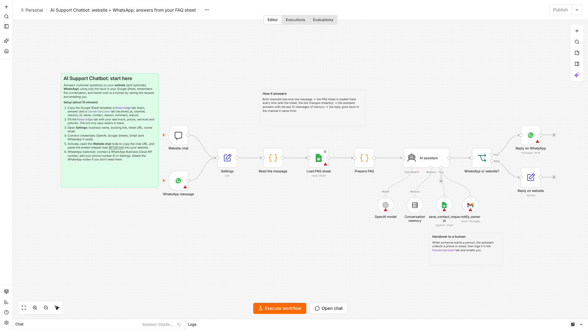

# AI Support Chatbot: setup guide

A chat assistant for the business's **website** (and optionally **WhatsApp**) that answers from the business's own FAQ Google Sheet, remembers the conversation, and hands over to a human by saving the customer's contact details and emailing the owner.

**Files:** `ai-support-chatbot.workflow.json` · `knowledge-base-template.csv` · `conversations-sheet-template.csv` · `website-embed-snippet.html`
**Setup time:** about 15 minutes (plus WhatsApp approval if used) · **Tested on:** n8n 2.42

---

## What you need
| Account | Used for |
|---|---|
| n8n (Cloud or self-hosted) | Runs the bot |
| OpenAI API key | The assistant (default model `gpt-5-mini`) |
| Google account | FAQ sheet + handover log (Sheets), owner alerts (Gmail) |
| WhatsApp Business Cloud API (optional) | WhatsApp channel, set up in Meta's developer console |

## Step by step

1. **Create the sheet.** New Google Sheet with two tabs:
   - `Knowledge`: paste `knowledge-base-template.csv` and replace the examples with the business's real facts. One row per topic. Any columns work; every non-empty cell is given to the AI.
   - `Conversations`: paste the header row from `conversations-sheet-template.csv`.
2. **Import** `ai-support-chatbot.workflow.json` into n8n.
3. **Fill in Settings:** business name, assistant name, what the business does, tone, booking link, phone for humans, sheet URL, owner email.
4. **Connect credentials** on the nodes with red warnings: OpenAI, Google Sheets (`Load FAQ sheet`, `save_contact_request`), Gmail (`notify_owner`).
5. **Activate**, then open the **Website chat** node and copy the **Production URL**.
   - Quick demo: open that URL in a browser. It is a ready-made chat page you can share.
   - On the website: paste `website-embed-snippet.html` before `</body>` and replace `YOUR_CHAT_URL`. Change the colours at the top of the snippet to match the brand.
6. **WhatsApp (optional):**
   1. In Meta for Developers create an app → add WhatsApp → add and verify the business phone number.
   2. In n8n create a **WhatsApp OAuth** credential (app ID and secret) for the trigger and a **WhatsApp API** credential (permanent access token, business account ID) for the reply node.
   3. Put the **Phone number ID** in Settings (`whatsapp_phone_number_id`).
   4. Activate. n8n registers the webhook with Meta automatically.

   Not using WhatsApp? Delete the `WhatsApp message` and `Reply on WhatsApp` nodes.
7. **Error alerts:** set `../shared/error-alert.workflow.json` as the Error workflow.

## Writing a good Knowledge tab
- One fact per row, written the way you'd say it to a customer: "Check-ups cost $90 and take 30 minutes."
- Cover the top 20 questions: hours, location/parking, prices, services, booking, cancellations, payment, insurance, service area, emergencies.
- Anything **not** in the sheet, the bot won't claim. It offers a human instead. That keeps it safe.
- Edits apply instantly: the sheet is read on every message.

## Test it
Open the chat URL and try:
1. "What are your opening hours?" → answered from the sheet.
2. "Do you do X?" (something not in the sheet) → says it's not sure and offers a person.
3. "Can someone call me back? I'm Sam, 555 123 4567" → a row appears in `Conversations` and the owner gets an email.

## Troubleshooting
| Problem | Fix |
|---|---|
| Chat bubble doesn't appear | Check the snippet is in the page and `YOUR_CHAT_URL` is the **production** URL, and the workflow is active. |
| "Error: Failed to receive response" | Open n8n *Executions* to see the failing step; usually a missing credential or wrong sheet tab name. |
| Bot says it doesn't know things that are in the sheet | Check `knowledge_tab` matches the tab name exactly and the sheet is shared with the connected Google account. |
| WhatsApp messages don't arrive | Make sure the number is verified, the app is in Live mode, and only **one** n8n workflow uses this WhatsApp app (Meta allows one webhook per app). |
| WhatsApp replies fail after 24h of silence | WhatsApp only allows free-form replies within 24 hours of the customer's last message, which normal support chats always are. |

## Customising
- Personality and rules live in the **AI assistant** node's system message.
- Remember more or less history: **Conversation memory → Context window length** (default 12 messages). Memory is held in n8n; for multi-server setups switch to Postgres or Redis chat memory.
- Add tools the assistant can use, e.g. a Cal.com availability check, an order-status lookup, or a CRM node.
