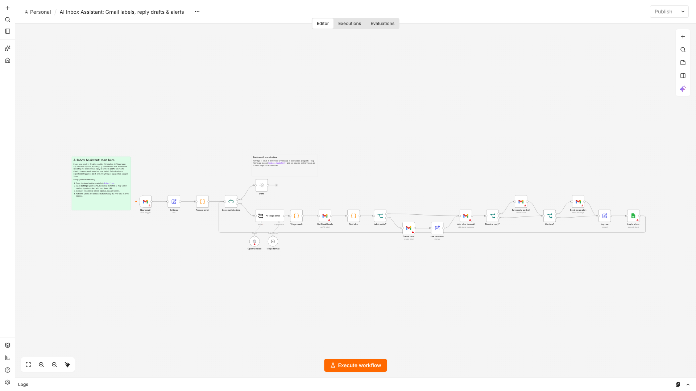

# AI Inbox Assistant: setup guide

Every new Gmail email is read by AI, **labelled** (AI/Sales lead, AI/Customer support, AI/Billing, AI/Scheduling, AI/Personal, AI/Newsletter, AI/Notification, AI/Spam, AI/Other), **summarised**, and, when a real person is waiting for an answer, a **reply draft** is saved in the same Gmail thread. Sales leads and urgent emails trigger an alert email. Every email is logged to a Google Sheet.

It **never sends email to customers**: drafts wait for a human to check and press Send.

**Files:** `ai-inbox-assistant.workflow.json` · `inbox-log-sheet-template.csv`
**Setup time:** about 10 minutes · **Tested on:** n8n 2.42

---

## What you need
| Account | Used for |
|---|---|
| n8n (Cloud or self-hosted) | Runs the assistant (checks Gmail every minute) |
| OpenAI API key | Triage and reply drafts (default model `gpt-5-mini`; well under 1 cent per email) |
| Google account | Gmail (the inbox to manage) and Google Sheets (the log) |

## Step by step
1. **Create the log sheet.** New Google Sheet → rename the tab `Inbox log` → paste the header row from `inbox-log-sheet-template.csv`.
2. **Import** `ai-inbox-assistant.workflow.json`.
3. **Fill in Settings:**
   | Setting | What to put |
   |---|---|
   | `your_name`, `your_role_and_business` | So drafts are written as you |
   | `facts_for_replies` | Hours, prices, links and policies the AI may use in drafts. Anything missing becomes `[CHECK: ...]` in the draft |
   | `tone`, `signature` | How drafts sound and end |
   | `alert_email` | Where lead/urgent alerts go (can be the same Gmail) |
   | `label_prefix` | Labels are created as `AI/...` by default |
   | `log_sheet_url`, `log_tab` | The sheet from step 1 |
4. **Connect credentials:** Gmail (trigger and all Gmail nodes), OpenAI, Google Sheets.
5. **Activate.** New unread emails are processed within about a minute. Labels are created automatically the first time each is needed.
6. **Error alerts:** set `../shared/error-alert.workflow.json` as the Error workflow.

## What it does with each email
| Category | Label | Draft reply? | Alert? |
|---|---|---|---|
| Sales lead (new customer, quote/price request) | AI/Sales lead | Yes | Yes, always |
| Customer support, billing, scheduling, personal | AI/... | If someone is waiting for an answer | Only if urgent |
| Newsletter, notification, spam | AI/... | Never | Never |
| From no-reply / automated senders | AI/... | Never | Only if urgent |

The trigger only looks at **unread inbox** mail not sent by you, and ignores its own `[Inbox Assistant]` alerts, so it never loops.

## Test it
Send an email to the connected inbox from another address: "Hi, how much would it cost to replace a water heater this week?" Within a minute or two:
- the email gets the `AI/Sales lead` label,
- a reply draft appears in the thread (Drafts),
- you get an `[Inbox Assistant] 💰 New lead` alert,
- a row appears in the log sheet.

## Troubleshooting
| Problem | Fix |
|---|---|
| Nothing happens | Workflow active? The email must be **unread** and in the **inbox** when n8n checks. |
| "Label name exists or conflicts" | A label with the same name but different case exists; rename it or change `label_prefix`. |
| Drafts are too generic | Add more detail to `facts_for_replies` (prices, links, policies, FAQs). |
| Too many alerts | In **Triage result**, change the `alert` rule (for example only `sales_lead`). |

## Customising
- Different categories: edit the list in **AI: triage email** and the matching names in **Triage result**.
- Slack or Telegram alerts: replace **Send me an alert** with the Slack/Telegram node.
- Outlook: swap the Gmail nodes for Microsoft Outlook nodes (trigger, categories, create draft, send).
- Auto-archive newsletters: add a Gmail "Remove label INBOX" step for the newsletter category.
